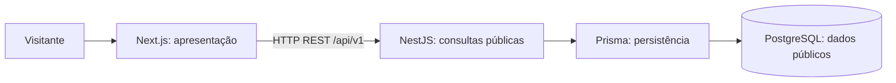

# MVP: catálogo público de personagens

## Escopo

Qualquer visitante pode abrir `/personagens`, consultar o catálogo e navegar para `/personagens/{slug}`. Todo conteúdo deve estar aprovado para divulgação pública. Não há login, painel administrativo, edição pela API, filtros avançados, upload ou comunicação real-time neste incremento.

## Responsabilidades e fluxo

- **Frontend:** renderizar catálogo e detalhe, navegação, estados vazio/erro/carregamento e interface responsiva e acessível. Consumir contratos públicos; não acessar Prisma nem o banco diretamente. A distribuição de consultas entre renderização no servidor e cliente será definida na implementação, sem duplicar regras de negócio.
- **Backend:** validar parâmetros, consultar dados, definir DTOs de resposta e erros HTTP. Expor somente campos públicos explicitamente selecionados. Começar com controller, service e acesso Prisma necessários ao fluxo; não introduzir repositórios genéricos ou camadas vazias.
- **Prisma:** manter schema, acesso tipado e migrations sob responsabilidade de `apps/api`. Tipos gerados não constituem o contrato HTTP e não devem ser importados pelo frontend.
- **PostgreSQL:** preservar unicidade e integridade referencial do modelo público. Credenciais não chegam ao navegador. Separar privilégios de consulta dos necessários a migrations e carga de dados; o procedimento editorial está pendente.

## Contrato HTTP mínimo planejado

| Método e rota | Resultado |
|---|---|
| `GET /api/v1/characters` | `200`, objeto com `items`, lista ordenada por nome e slug como desempate |
| `GET /api/v1/characters/{slug}` | `200`, personagem; `404` se não existir |

O resumo de catálogo contém `slug`, `name`, `summary` e `clan` (objeto com `slug` e `name`, ou `null`). O detalhe acrescenta `description`. A lista vazia retorna `items: []`. Erros usam um objeto `error` com `code` estável e `message` pública, sem stack traces ou detalhes de banco. Parâmetros inválidos retornam `400`; falhas internas retornam `500` com mensagem genérica.

O MVP começa com coleção pequena, sem paginação ou busca. Reavaliar esse contrato antes de carregar um catálogo que torne a resposta integral inadequada. Não há endpoint de clãs independente: o vínculo necessário é retornado junto ao personagem. Não registrar rotas de criação, alteração ou exclusão; verificar que requisições de escrita não alteram dados. Respostas técnicas de protocolo não são endpoints editoriais.

Os campos estão descritos conceitualmente em [modelo de domínio](./domain-model.md). A tarefa de implementação deve formalizar o schema HTTP e seus exemplos sintéticos sem compartilhar entidades Prisma. Origem da API, proxy, CORS e cache dependem da [topologia pendente](./pending-decisions.md).

## Critérios de aceite do primeiro fluxo

1. Um visitante sem sessão abre `/personagens` e vê nome, resumo e clã quando presente, com link identificável para cada detalhe.
2. A navegação e o acesso direto a `/personagens/{slug}` mostram nome, resumo, descrição pública e clã quando presente; existe retorno ao catálogo.
3. Catálogo vazio apresenta mensagem clara. Slug inexistente resulta em página de não encontrado e resposta HTTP `404` apropriada.
4. Durante consultas no cliente há indicação de carregamento; quando a renderização exigir espera no servidor, a navegação também oferece retorno visual. Falhas mostram mensagem compreensível e possibilidade de tentar novamente, sem informações internas.
5. Links funcionam por teclado, foco é visível, títulos têm hierarquia coerente e a página é legível em telas estreitas sem rolagem horizontal. Validar contraste e nomes acessíveis durante a implementação.
6. API responde aos dois GETs conforme o contrato, incluindo catálogo vazio, parâmetros inválidos, detalhe inexistente e falha interna. A ordenação é determinística.
7. Não existem login, operações administrativas ou rotas de escrita de negócio. Tentativas de escrita são rejeitadas e o banco permanece inalterado.
8. Respostas usam seleção explícita dos campos definidos. Banco público, fixtures, logs e exemplos não contêm spoilers, dados privados ou credenciais.
9. Verificações automatizadas futuras cobrem contrato e erros relevantes da API, integridade do vínculo com clã e o percurso catálogo → detalhe. A revisão visual e de teclado complementa esses testes.

Estes são critérios para a aplicação futura; não foram executados como testes de software na CDC-003.
